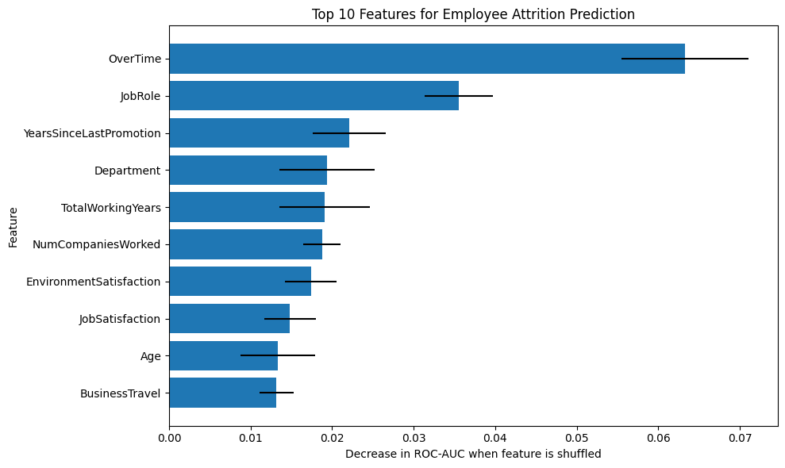

# Employee Attrition Prediction

## 1. Business Problem

Employee attrition is a significant challenge for organizations because employee turnover can increase recruitment costs, disrupt team productivity, and result in the loss of experienced employees.

Identifying employees who may be at a higher risk of leaving can help organizations better understand workforce trends and explore opportunities to improve employee retention.

## 2. Project Objective

The objective of this project is to develop a machine learning classification model that predicts whether an employee is likely to leave an organization based on available employee information.

The project focuses on:

- Exploring employee demographics, job characteristics, compensation, work experience, and satisfaction levels.
- Identifying patterns associated with employee attrition through exploratory data analysis.
- Building and comparing classification models, including Logistic Regression, Decision Tree, Random Forest, and XGBoost.
- Evaluating model performance using precision, recall, F1-score, and ROC-AUC, with particular attention to identifying employees who leave.
- Interpreting model predictions using permutation importance and logistic regression coefficients.

## 3. Business Value

Early identification of employees at higher risk of attrition could help HR teams prioritize retention conversations, review workload and overtime patterns, and explore career development opportunities.

The analysis highlights factors associated with attrition, including overtime, job role, career progression, and employee satisfaction. These findings can guide further investigation and help HR teams make more informed decisions.

## 4. Dataset

This project uses the IBM HR Analytics Employee Attrition dataset, which contains employee information such as demographics, job roles, compensation, work experience, job satisfaction, and attrition status.

- **Target variable:** `Attrition`
- **Problem type:** Binary classification
- **Target classes:** `Yes` (employee left) and `No` (employee stayed)
- **Objective:** Identify patterns associated with employee attrition and predict attrition using available employee features.

The dataset contains approximately 1,470 employee records. The target variable is imbalanced, with fewer employees leaving than staying.

## How to Run

1. Clone or download this repository.
2. Install the required dependencies:

   ```bash
   pip install -r requirements.txt
   ```

3. Open `Project_1_Employee_Attrition.ipynb` in Jupyter Notebook, JupyterLab, or VS Code.
4. Ensure the dataset is available at the expected path inside the `data/` folder.
5. Run the notebook cells from top to bottom.

## 5. Methodology

### Exploratory Data Analysis (EDA)
- Examined the distribution of attrition and checked for missing values and duplicate records.
- Compared employee characteristics across attrition groups using summary statistics and visualizations.
- Analysed relationships between numerical and categorical features to identify patterns associated with attrition.

### Data Preprocessing
- Separated the target variable (`Attrition`) from the input features.
- Split the data into training and testing sets using stratified sampling.
- Standardized numerical features and one-hot encoded categorical features.
- Used cross-validation on the training data to evaluate model performance.

### Model Development
The following classification models and approaches were evaluated:

- Logistic Regression
- Decision Tree
- Random Forest
- XGBoost
- Class-weighting and SMOTENC experiments to investigate the effect of class imbalance
- Hyperparameter tuning to improve model performance

### Model Evaluation
Models were compared using accuracy, precision, recall, F1-score, and ROC-AUC. Particular attention was given to recall and F1-score because identifying employees who leave is important in an imbalanced classification problem.

Permutation importance and Logistic Regression coefficients were also examined to understand which features contributed to predictions.

## 6. Model Results

The models were compared using cross-validation on the training data. Since the target variable is imbalanced, F1-score and ROC-AUC were considered alongside accuracy and precision.

| Model | Accuracy | Precision | Recall | F1-Score | ROC-AUC |
|---|---:|---:|---:|---:|---:|
| Logistic Regression | 0.891 | 0.793 | 0.442 | 0.565 | 0.838 |
| Weighted Logistic Regression | 0.748 | 0.364 | 0.732 | 0.485 | 0.827 |
| Tuned Logistic Regression | 0.892 | 0.789 | 0.453 | **0.572** | 0.835 |
| SMOTENC + Logistic Regression | 0.827 | 0.476 | 0.600 | 0.530 | 0.815 |
| Decision Tree | 0.790 | 0.354 | 0.368 | 0.360 | 0.620 |
| Random Forest | 0.863 | 0.893 | 0.189 | 0.302 | 0.800 |
| Weighted Random Forest | 0.857 | 0.872 | 0.147 | 0.245 | 0.791 |
| XGBoost | 0.872 | 0.725 | 0.337 | 0.456 | 0.809 |
| Weighted XGBoost | 0.870 | 0.656 | 0.411 | 0.500 | 0.794 |
| Tuned XGBoost | 0.878 | 0.723 | 0.395 | 0.507 | 0.826 |

### Results Summary

Tuned Logistic Regression achieved the highest F1-score among the evaluated models, while baseline Logistic Regression achieved the highest ROC-AUC. The tuned Logistic Regression model was selected as the final candidate because it offered the best precision-recall balance according to F1-score.

The experiments also showed that class-weighting and SMOTENC affected the trade-off between precision and recall. No single approach performed best across all metrics.

## 7. Key Findings



Permutation importance and Logistic Regression coefficients helped identify patterns associated with employee attrition.

- **OverTime:** The strongest predictor in the permutation importance analysis. This highlights the importance of investigating workload and work-life balance.
- **JobRole:** The second most important feature, suggesting that attrition patterns vary across job roles.
- **Career progression:** YearsSinceLastPromotion, TotalWorkingYears, and NumCompaniesWorked contributed to the model's predictions.
- **Employee satisfaction:** JobSatisfaction and EnvironmentSatisfaction provided additional predictive information.
- **BusinessTravel:** Travel requirements also contributed to predicting attrition.

These findings can help HR teams identify areas for further investigation, including workload distribution, career development, and employee satisfaction. However, the model identifies associations rather than proving what causes employees to leave.

## 8. Limitations and Future Improvements

### Limitations
- **Class imbalance:** Fewer employees left than stayed, making attrition cases harder to identify.
- **Missed cases:** The final model did not identify every employee who left.
- **Generalizability:** The analysis uses a single dataset, so the results may not apply to every organization.
- **Predictive associations:** Feature importance and model coefficients do not establish causation.

### Future improvements

Implement nested cross-validation to obtain a more robust estimate of model performance and further investigate ways to improve recall.